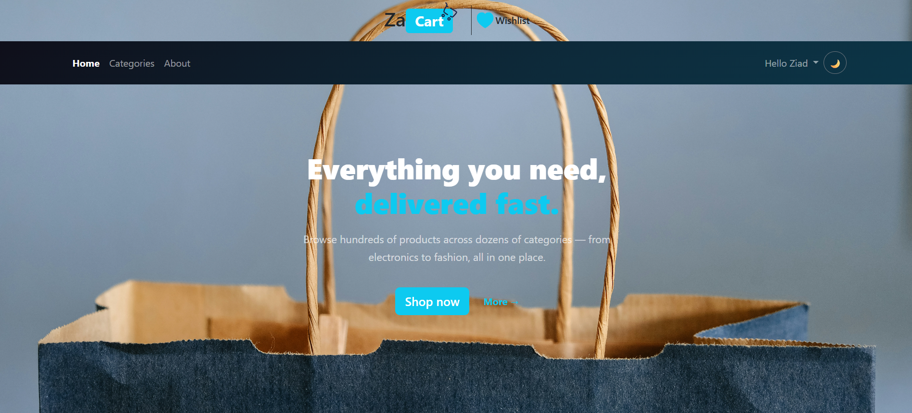
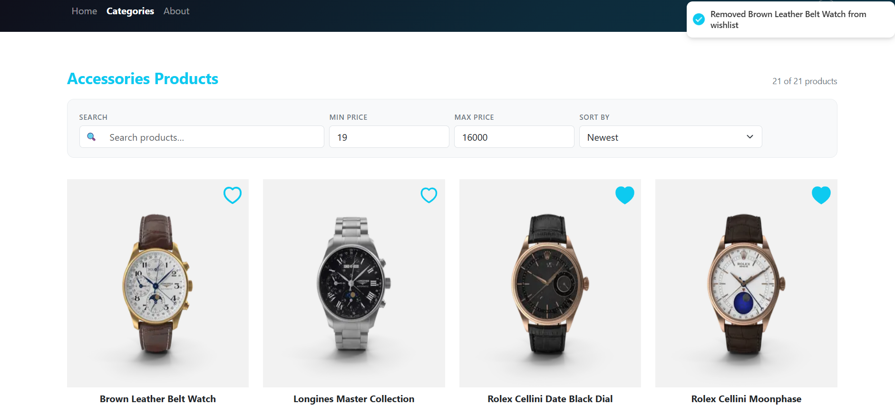
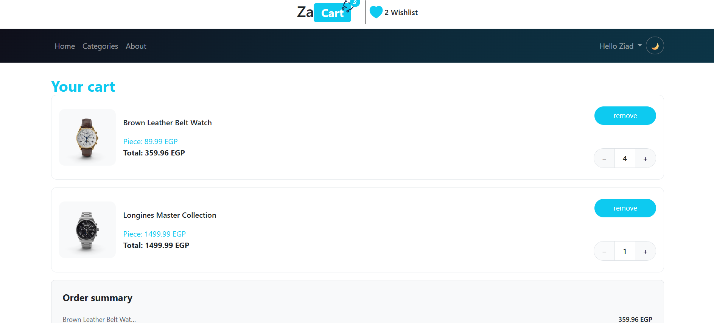
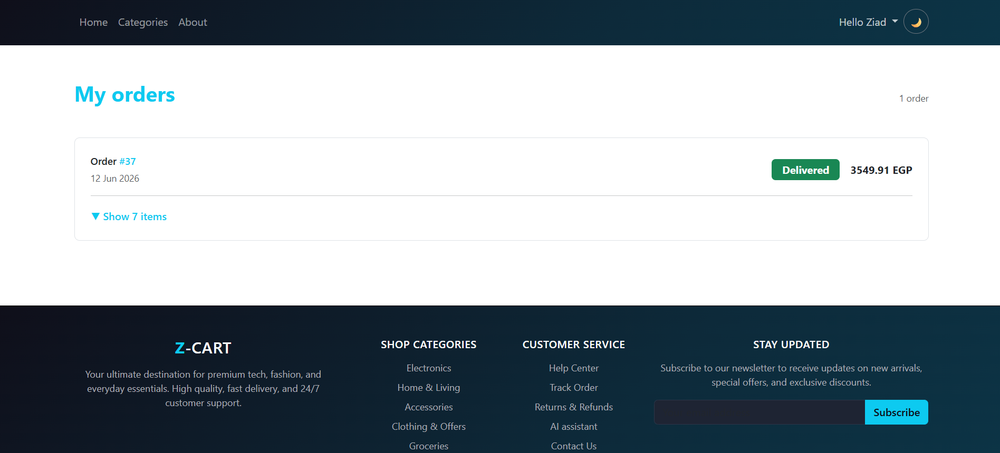
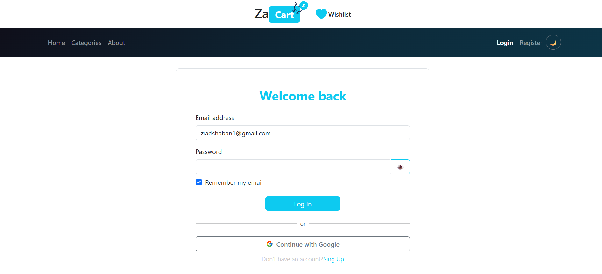

# Za-Cart 🛒

A full-stack e-commerce web application built with React 18, TypeScript, Redux Toolkit, Supabase, and Stripe — developed as a production-grade portfolio project.

---

## 🌐 Live Demo

## https://za-cart-icot.vercel.app/

## 📋 Table of Contents

- [Tech Stack](#tech-stack)
- [Features](#features)
- [Project Architecture](#project-architecture)
- [Payment Flow](#payment-flow)
- [Folder Structure](#folder-structure)
- [Screenshots](#Screenshots)
- [Getting Started](#getting-started)
- [Environment Variables](#environment-variables)
- [Supabase Setup](#supabase-setup)
- [Stripe Setup](#stripe-setup)
- [Database Schema](#database-schema)
- [Testing Payments](#testing-payments)
- [Deployment](#deployment)
- [Scripts](#scripts)

---

## 🧰 Tech Stack

| Layer               | Technology                                              |
| ------------------- | ------------------------------------------------------- |
| Frontend framework  | React 18 + TypeScript                                   |
| Build tool          | Vite                                                    |
| State management    | Redux Toolkit                                           |
| Routing             | React Router v6                                         |
| UI library          | React Bootstrap 5.3                                     |
| Forms & validation  | React Hook Form + Zod                                   |
| Backend / Auth / DB | Supabase (PostgreSQL + Auth + Storage + Edge Functions) |
| Payments            | Stripe Checkout (hosted)                                |
| Animations          | Lottie via @lottiefiles/react-lottie-player             |
| Notifications       | react-hot-toast                                         |
| Skeleton loading    | react-content-loader                                    |

---

## ✨ Features

### Core E-commerce

- Browse products by category with URL-synced filters (search, price range, sort)
- Product detail page with stock tracking, quantity selector, and breadcrumb navigation
- Shopping cart with quantity controls, coupon codes, and estimated delivery date
- Stripe-powered secure checkout with hosted payment page
- Order history with expandable order cards showing items and shipping address

### Authentication

- Email/password registration and login with Zod validation
- Google OAuth sign-in
- "Remember me" via localStorage
- Protected routes for checkout, orders, profile, and wishlist

### User Experience

- Full dark/light mode via Bootstrap 5.3 `data-bs-theme` — no hardcoded colours
- Back-to-top button (appears after 300px scroll)
- Recently viewed products stored in localStorage (last 4), shown on product detail page
- Product card hover overlay with "View details" link
- Wishlist with recommended products when empty
- Toast notifications on every user action
- `aria-label` on all interactive icon elements
- Escape key closes all modals
- `loading="lazy"` on every image
- React.lazy + Suspense code splitting on every route

### Payment (Stripe)

- Secure Stripe Checkout Session created server-side via Supabase Edge Function
- Webhook-based order fulfilment — orders created only after confirmed payment
- Signature verification on every webhook event
- Idempotency guard prevents duplicate orders on webhook retry
- Cart cleared server-side by webhook even if user closes the tab

---

## 🏗️ Project Architecture

```
Browser (React)
    │
    │  1. User clicks "Pay"
    ▼
Redux Thunk: actCreateCheckoutSession
    │
    │  2. POST cart + shipping data
    ▼
Supabase Edge Function: create-checkout-session
    │
    │  3. Create Stripe Checkout Session (secret key server-side only)
    ▼
Stripe Servers
    │
    │  4. User pays on Stripe's hosted page
    │
    ├──────── SUCCESS ────────────────────────────┐
    │                                             │
    │  5a. Stripe redirects to /checkout/success  │
    │  5b. Stripe fires webhook event             │
    │                                             ▼
    │                              Supabase Edge Function: stripe-webhook
    │                                  │  verify signature
    │                                  │  idempotency check
    │                                  │  INSERT order + orderItems
    │                                  │  DELETE cart
    │                                  ▼
    │                              Supabase PostgreSQL
    │
    └──────── CANCELLED ──────────────────────────▶  /checkout/cancel  (no DB write)
```

---

## 💳 Payment Flow

The payment flow uses **Stripe Checkout** (hosted page) — the recommended Stripe integration for e-commerce. Card details never pass through your server.

| Step | Who does it      | What happens                                             |
| ---- | ---------------- | -------------------------------------------------------- |
| 1    | Frontend         | User clicks "Pay X EGP" on Review step                   |
| 2    | Redux thunk      | Calls Supabase Edge Function with cart + shipping data   |
| 3    | Edge Function    | Creates Stripe Checkout Session with order in `metadata` |
| 4    | Stripe           | User enters card on Stripe's page (PCI compliant)        |
| 5    | Stripe → Webhook | Fires `checkout.session.completed` on success            |
| 6    | Edge Function    | Verifies signature, inserts order, clears cart           |
| 7    | Frontend         | Stripe redirects to `/checkout/success`, cart cleared    |

**Why webhooks are the source of truth:** The success page URL can be typed manually by anyone. The webhook is signed with HMAC-SHA256 — cryptographically impossible to fake without the webhook secret.

---

## 📁 Folder Structure

```
za-cart/
├── public/
├── src/
│   ├── assets/             # Images, SVGs, Lottie JSON files
│   ├── components/
│   │   ├── auth/           # ProtectedRoutes
│   │   ├── common/         # Header, Footer, BackToTop, GridList, Heading, PasswordInput
│   │   └── ecommerce/      # Product, CartItem, OrderCard, checkout steps, wishlist
│   │   └── feedback/       # Skeletons, LottiesHandler, LoadingError
│   ├── context/            # ThemeContext (dark/light mode)
│   ├── hooks/              # usePageTitle, useRecentlyViewed
│   ├── layouts/            # MainLayout
│   ├── pages/
│   │   ├── home/
│   │   ├── products/
│   │   ├── product-details/
│   │   ├── checkout/       # Checkout, PaymentSuccess, PaymentCancel
│   │   ├── orders/
│   │   └── ...             # Cart, WishList, Profile, LogIn, Register, Categories
│   ├── services/           # supabase.ts client
│   ├── store/
│   │   ├── auth/           # AuthSlice, actAuthLogIn, actAuthRegister, actUpdateProfile
│   │   ├── cart/           # CartSlice, actGetItemsInfo, actSyncCart
│   │   ├── categories/     # CategoriesSlice, actCategories
│   │   ├── orders/         # OrdersSlice, actGetOrders
│   │   ├── payment/        # paymentSlice, actCreateCheckoutSession  ← Stripe
│   │   ├── products/       # ProductsSlice, actProducts, actGetProductById, etc.
│   │   ├── wishlist/       # WishListSlice, actLikeToggle, actGetLikedProducts
│   │   ├── store.ts
│   │   └── hooks.ts
│   ├── styles/             # global.css
│   ├── types/              # product.ts, orders.ts, category.ts, shared.ts
│   ├── utilits/            # toast.ts
│   ├── validations/        # checkout.ts, Login.ts, Register.ts
│   └── App.tsx
│
├── supabase/
│   ├── functions/
│   │   ├── _shared/
│   │   │   └── cors.ts                        ← shared CORS headers
│   │   ├── create-checkout-session/
│   │   │   └── index.ts                       ← creates Stripe session (server)
│   │   └── stripe-webhook/
│   │       └── index.ts                       ← handles payment events (server)
│   └── migrations/
│       └── add_stripe_payment_fields.sql      ← DB migration for Stripe columns
│
├── STRIPE_SETUP.md         ← detailed Stripe setup & testing guide
├── .env.local              ← local environment variables (not committed)
└── package.json
```

---

## Screenshots

## Home Page



# Products Page



## Cart Page



## Orders Page



## Login Page

## 

## 🚀 Getting Started

### Prerequisites

- Node.js 18+
- npm or yarn
- A Supabase account (free tier works)
- A Stripe account (free, test mode works without real money)

### 1. Clone and install

```bash
git clone https://github.com/your-username/za-cart.git
cd za-cart
npm install
```

### 2. Set up environment variables

Create a `.env.local` file in the project root:

```env
VITE_SUPABASE_URL=https://your-project-ref.supabase.co
VITE_SUPABASE_ANON_KEY=your-anon-key-here
VITE_SUPABASE_FUNCTIONS_URL=https://your-project-ref.supabase.co/functions/v1
```

> Get these from: Supabase Dashboard → Settings → API

### 3. Run the database migration

In Supabase Dashboard → SQL Editor, run the contents of:

```
supabase/migrations/add_stripe_payment_fields.sql
```

### 4. Start the development server

```bash
npm run dev
```

Open [http://localhost:5173](http://localhost:5173)

---

## 🔑 Environment Variables

### Frontend (`.env.local`)

| Variable                      | Description              | Where to find it                         |
| ----------------------------- | ------------------------ | ---------------------------------------- |
| `VITE_SUPABASE_URL`           | Supabase project URL     | Supabase → Settings → API                |
| `VITE_SUPABASE_ANON_KEY`      | Supabase public anon key | Supabase → Settings → API                |
| `VITE_SUPABASE_FUNCTIONS_URL` | Edge Functions base URL  | `https://<ref>.supabase.co/functions/v1` |

### Supabase Edge Function Secrets (server-side only)

Set via `supabase secrets set` CLI or Supabase Dashboard → Edge Functions → Secrets:

| Variable                | Description            | Where to find it                            |
| ----------------------- | ---------------------- | ------------------------------------------- |
| `STRIPE_SECRET_KEY`     | Stripe secret key      | Stripe Dashboard → Developers → API Keys    |
| `STRIPE_WEBHOOK_SECRET` | Webhook signing secret | Stripe Dashboard → Webhooks → your endpoint |

> ⚠️ `STRIPE_SECRET_KEY` must NEVER appear in frontend code or `.env.local`.

---

## 🗄️ Supabase Setup

### Tables required

**products**

```sql
id, name, price, image, stock, category_id, description, is_featured
```

**categories**

```sql
id, name, image
```

**cart**

```sql
id, user_id, product_id, quantity
```

**orders**

```sql
id, user_id, total_price, status, payment_status,
stripe_session_id, shipping_address (JSONB), created_at
```

**orderItems**

```sql
id, order_id, product_id, name, image, price, quantity
```

**wishlist**

```sql
id, user_id, product_id
```

### Row Level Security

Enable RLS on all tables. Users should only be able to read/write their own data. The Stripe webhook uses the **service role key** to bypass RLS for order insertion.

---

## 💳 Stripe Setup

For the complete step-by-step Stripe setup guide, see **[STRIPE_SETUP.md](./STRIPE_SETUP.md)**.

### Quick overview

```bash
# Install Supabase CLI
npm install -g supabase

# Link your project
supabase link --project-ref YOUR_PROJECT_REF

# Deploy Edge Functions
supabase functions deploy create-checkout-session --no-verify-jwt
supabase functions deploy stripe-webhook --no-verify-jwt

# Set secrets
supabase secrets set STRIPE_SECRET_KEY=sk_test_xxx
supabase secrets set STRIPE_WEBHOOK_SECRET=whsec_xxx
```

Then register your webhook URL in Stripe Dashboard → Developers → Webhooks:

```
https://YOUR_PROJECT_REF.supabase.co/functions/v1/stripe-webhook
```

Listen for: `checkout.session.completed`

---

## 🧪 Testing Payments

Use these Stripe test cards on the hosted checkout page:

| Scenario              | Card Number           | Result                           |
| --------------------- | --------------------- | -------------------------------- |
| ✅ Payment succeeds   | `4242 4242 4242 4242` | Order created in DB              |
| ❌ Card declined      | `4000 0000 0000 0002` | Redirected to `/checkout/cancel` |
| 🔐 3D Secure required | `4000 0025 0000 3155` | 3DS challenge shown              |
| 💳 Insufficient funds | `4000 0000 0000 9995` | Declined message on Stripe page  |

Use any future expiry (e.g. `12/34`), any CVC (e.g. `123`), any ZIP (e.g. `12345`).

### Test webhooks locally

```bash
# Install Stripe CLI
brew install stripe/stripe-cli/stripe   # macOS

# Login
stripe login

# Forward webhooks to your deployed Edge Function
stripe listen --forward-to https://YOUR_REF.supabase.co/functions/v1/stripe-webhook

# Trigger a test event
stripe trigger checkout.session.completed
```

---

## 🗃️ Database Schema

### Migration: Stripe payment fields

```sql
-- Tracks payment state separately from fulfilment status
ALTER TABLE orders
  ADD COLUMN IF NOT EXISTS payment_status TEXT NOT NULL DEFAULT 'unpaid'
  CHECK (payment_status IN ('unpaid', 'paid', 'refunded', 'failed'));

-- Stores Stripe session ID — UNIQUE prevents duplicate orders
ALTER TABLE orders
  ADD COLUMN IF NOT EXISTS stripe_session_id TEXT UNIQUE;

-- Index for fast webhook idempotency lookups
CREATE INDEX IF NOT EXISTS idx_orders_stripe_session_id
  ON orders (stripe_session_id);
```

---

## 🚢 Deployment

### Frontend (Vercel — recommended)

1. Push to GitHub
2. Connect repo on [vercel.com](https://vercel.com)
3. Add environment variables in Vercel project settings
4. Deploy

### Edge Functions (Supabase)

```bash
supabase functions deploy create-checkout-session --no-verify-jwt
supabase functions deploy stripe-webhook --no-verify-jwt
```

### Production checklist

- [ ] Switch `STRIPE_SECRET_KEY` to live key (`sk_live_xxx`)
- [ ] Register a new Stripe webhook endpoint with production URL
- [ ] Copy new `whsec_xxx` to Supabase secrets
- [ ] Update `Access-Control-Allow-Origin` in `cors.ts` to your production domain
- [ ] Enable Stripe Radar (free fraud protection)
- [ ] Test one real payment before launch

---

## 📜 Scripts

```bash
npm run dev        # Start development server (localhost:5173)
npm run build      # TypeScript check + Vite production build
npm run preview    # Preview production build locally
npm run lint       # ESLint check
```

---

## 🔐 Security Notes

- Stripe secret key lives only in Supabase Edge Function secrets — never in the browser
- All webhook events verified with HMAC-SHA256 signature before processing
- Orders are created only by the webhook, never by the frontend
- Idempotency enforced in code (early return) and at DB level (UNIQUE constraint)
- Supabase RLS enabled on all user tables
- Webhook handler uses service role key (bypasses RLS) only on the server

---

## 🧠 Key Architecture Decisions

**Why Stripe Checkout (hosted) instead of Stripe Elements (custom form)?**
Checkout is PCI-DSS compliant out of the box. Elements requires you to handle and secure card fields yourself, adding PCI compliance obligations to your server.

**Why Supabase Edge Functions instead of a separate Express server?**
The project uses Supabase for everything (auth, DB, storage). Edge Functions run in the same ecosystem with zero server management, auto-scaling, and secrets management built in.

**Why webhooks instead of the success page for order creation?**
The success page URL can be navigated to without paying. Webhooks are cryptographically signed by Stripe — they cannot be faked. This is the only production-safe pattern.

**Why metadata for order data?**
The webhook runs server-to-server with no access to Redux state or the user's browser session. Embedding order data in Stripe session metadata is the standard way to pass information from checkout initiation to webhook handler.

---

## 📄 License

MIT — free to use for portfolio and commercial projects.

---

Built with ❤️ by Ziad
